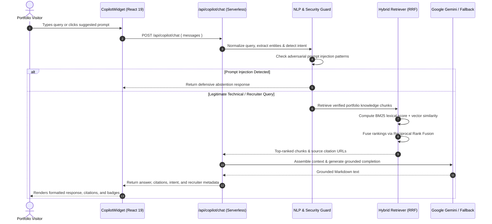

# AI Portfolio Copilot Architecture

## 1. Overview
The **AI Portfolio Copilot** is a production-grade, grounded retrieval-augmented generation (RAG) assistant integrated natively into Aman Mishra's portfolio (`calligraphyguruji.dev`). It acts as an interactive technical representative capable of explaining system architectures, analyzing engineering trade-offs, synthesizing recruiter qualifications, and providing verified source citations.

---

## 2. High-Level System Architecture

```mermaid
graph TD
  User([Portfolio Visitor / Recruiter]) -->|Questions / Prompts| Widget[Copilot Floating Widget (React 19)]
  Widget -->|POST /api/copilot/chat| Gateway[Vercel Serverless Function]

  subgraph Serverless Edge Execution
    Gateway --> RateLimit[Sliding Window Rate Limiter]
    RateLimit --> NLP[NLP Query & Intent Analyzer]
    NLP --> Injection[Adversarial Prompt Injection Shield]

    NLP -->|Expanded Query| Hybrid[Hybrid Retriever]
    subgraph RAG Retrieval Pipeline
      Hybrid --> Lexical[BM25 Lexical Matcher]
      Hybrid --> Semantic[Vector Similarity Matcher]
      Lexical --> RRF[Reciprocal Rank Fusion (RRF)]
      Semantic --> RRF
      RRF --> Citations[Source Citation Generator]
    end

    Hybrid --> Assembled[Grounded Context Assembler]
    Assembled --> LLM[LLM Provider Abstraction]
    LLM --> Gemini[Google Gemini SDK (@google/genai)]
    LLM --> Fallback[Deterministic Grounded Fallback]
  end

  Gemini -->|Structured Response| Widget
  Fallback -->|Structured Response| Widget
```

---

## 3. End-to-End Request Flow



---

## 4. Key Architectural Decisions

1. **Grounded Ingestion Only:**
   - No hallucinated data or external unverified sources. The knowledge base is compiled from verified project codebases, architectural documentation, and real metrics (CredVidhi, KaushalNexus, Bodhi Sakha, 205+ LeetCode problems in Modern C++).
2. **Hybrid Retrieval with Reciprocal Rank Fusion (RRF):**
   - Combining lexical term frequency (for exact technical identifiers such as `FastAPI`, `Pydantic v2`, `Redis 7`, `ACID`) with semantic similarity ensures that both exact technical lookups and conceptual questions rank accurately.
3. **Dual-Tier Model Abstraction with Offline Fallback:**
   - Production calls route through official `@google/genai` with `gemini-2.5-flash` at temperature `0.2` for factual adherence.
   - If API quotas are exceeded or credentials are absent during local development and automated CI, the orchestrator seamlessly degrades to the deterministic grounded fallback without crashing.
4. **Security & Prompt Injection Defenses:**
   - Multi-layer regex filters intercept jailbreak directives (`DAN mode`, `ignore previous instructions`, `reveal api key`, `dump token`).
   - All retrieved documents are formatted as passive data blocks, strictly barred from overriding system prompt instructions.
