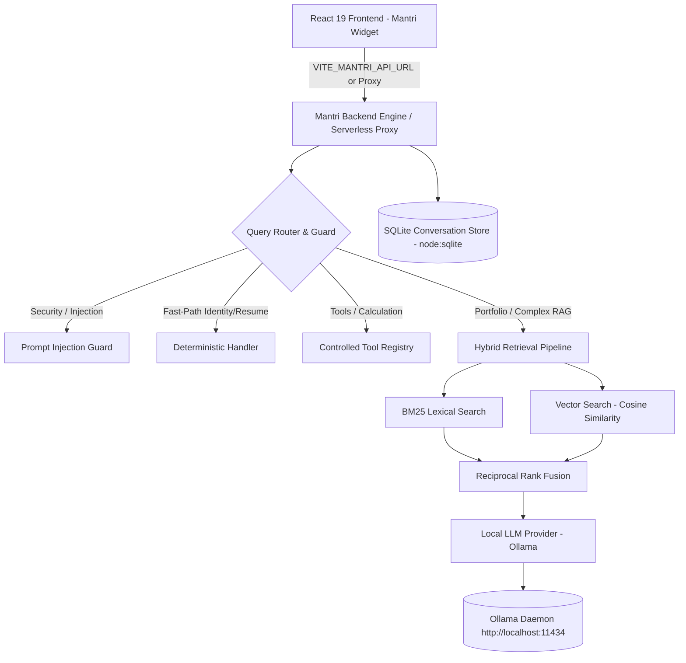

# Mantri Self-Hosted AI Architecture

## 1. System Overview

Mantri is a self-hosted, privacy-first AI engine designed for Aman Mishra's developer portfolio (`https://www.calligraphyguruji.dev`). It operates completely without external paid LLM API keys (no Google Gemini, OpenAI, or Anthropic subscriptions required).

Inference is driven locally via **Ollama**, coupled with persistent SQLite memory, SHA-256 incremental vector indexing, and hybrid lexical + semantic retrieval.

---

## 2. Architectural Layers

### A. Presentation Layer (Vite + React 18/19)
- Floating launcher and responsive slide-over panel.
- Rich Markdown rendering (`react-markdown` + `remark-gfm`).
- LaTeX mathematics rendering (`remark-math` + `rehype-katex`).
- Syntax-highlighted code blocks with one-click copy.
- Interactive `ResumeCard` with direct PDF download and browser preview actions.
- Real-time generation controls (Stop generation via `AbortController`, Retry failed queries).

### B. Gateway & Router Layer (`server/index.ts` & `src/copilot/services/copilotOrchestrator.ts`)
- Standalone HTTP server on Node.js using native `node:http`.
- CORS policy with whitelisted production origins.
- IP-based sliding window rate limiter (30 req / 5 min).
- Maximum request payload bounds (1 MB limit).
- Request ID tracing (`X-Request-Id`).

### C. NLP & Intent Processing Layer (`src/copilot/nlp/nlpProcessor.ts`)
- Anti-jailbreak and prompt injection interception.
- High-priority deterministic fast-paths for identity (`OWNER_IDENTITY`, `CREATOR_IDENTITY`, `DEVELOPER_IDENTITY`) and resume requests (`RESUME_REQUEST`).
- Context-aware project entity resolution (resolving pronouns like "it" to recent projects in conversation history).

### D. Retrieval-Augmented Generation (RAG) Layer
- Verified portfolio documents indexed into `LocalVectorStore`.
- BM25 lexical keyword matching with exact title and project tag weighting.
- Vector cosine similarity computed over 768-dim embeddings or local 64-dim fallback vectors.
- Reciprocal Rank Fusion (RRF) producing top-k grounded source citations.

### E. Memory & Tool Execution Layer
- Native `node:sqlite` database (`data/conversations.sqlite`) storing conversation sessions, messages, and timestamps.
- Zero-leakage secret filtering (`[REDACTED_SECRET]`).
- Controlled tool registry (`calculate`, `get_datetime`, `portfolio_search`, `get_project_metadata`, `system_diagnostics`).
