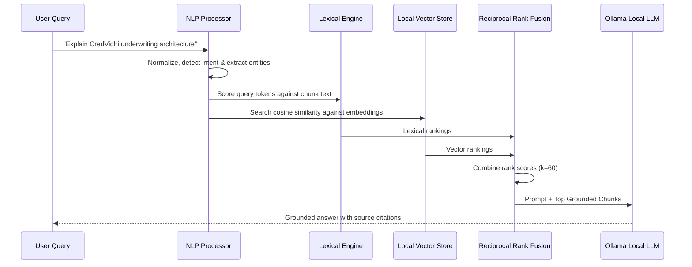

# Mantri Local RAG Pipeline

## 1. Overview

Mantri's RAG pipeline indexes verified facts from Aman Mishra's portfolio without sending raw data to external commercial vector databases. All chunking, hashing, embeddings, and ranking happen on-premises.

---

## 2. Pipeline Stages

---

## 3. Document Chunking & Hashing

1. **Source Documents**:
   - `src/copilot/data/verifiedKnowledge.ts`: Single source of truth for Aman's education, skills, projects (CredVidhi, KaushalNexus, Bodhi Sakha, LeetCode), and achievements.
2. **Structure-Aware Chunking**:
   - `chunkKnowledgeDocument()` splits documents along semantic section headers (`###`).
   - Every chunk receives:
     - `chunkId`: Stable identifier derived from document ID and section title.
     - `contentHash`: SHA-256 digest of content for incremental reindexing.
     - `keywords`: Extracted tokens for rapid BM25 matching.

---

## 4. Local Embeddings & Vector Search

- **Default Embedding Model**: `nomic-embed-text` via Ollama `/api/embeddings`.
- **Zero-Network Fallback**: Deterministic hash-based 64-dimensional float vector when the local Ollama daemon is offline or cold-starting.
- **Persistent Storage**: Saved as JSON records in `data/vector_store.json`.
- **Incremental Indexing**: If a document's SHA-256 hash matches the disk record, embedding generation is skipped, resulting in sub-millisecond start times.

---

## 5. Hybrid Retrieval & Reciprocal Rank Fusion (RRF)

Mantri combines keyword precision with semantic embeddings:

$$\text{RRF Score}(d) = \sum_{m \in M} \frac{1}{k + r_m(d)}$$

Where $k = 60$ and $r_m(d)$ is the rank of chunk $d$ in system $m \in \{\text{BM25}, \text{Vector}\}$.

This prevents vocabulary mismatches while guaranteeing that exact technical terms (e.g. `FastAPI`, `Pydantic v2`, `Redis 7`, `FSM`) receive optimal ranking.
